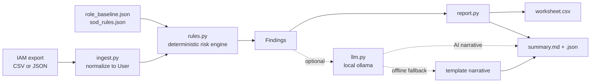

# access-review-autopilot

**Turn a messy IAM export into a ready-to-sign access certification in one command.**

User access reviews (a.k.a. access certification) are a recurring, manual GRC chore for
SOX, SOC 2 and ISO 27001: export every user and their entitlements, then eyeball who is
dormant, over-privileged, orphaned, or sitting on a toxic combination of permissions.
This tool does the eyeballing with a **deterministic risk engine** and hands the reviewer
a worksheet to approve/revoke on, plus a summary report for the audit file.

## Demo


## What it does

Feed it an identity export (**CSV or JSON** — same result either way) and it flags, per user:

- **Dormant accounts** — active but no login in N days (configurable).
- **Disabled-but-active anomalies** — account marked disabled yet recently logged in.
- **Over-privileged / high-risk entitlements** — admin / wildcard (`*`) / root grants.
- **Role-baseline mismatches** — entitlements that don't fit the user's department.
- **Orphaned accounts** — manager missing, blank, or no longer in the directory.
- **Separation-of-Duties (SoD) conflicts** — configurable toxic pairs (e.g. `ap:create` + `ap:approve`).
- **MFA disabled on privileged accounts**, and **stale accounts** (created long ago, never logged in).

Every finding carries: user, type, severity, **evidence**, and a recommended action
(review / revoke).

**Outputs** (written to `./out/`):
1) `access_review_worksheet.csv` — one row per flagged user+entitlement, with blank
   `decision` / `reviewer` / `notes` columns for the reviewer to fill in.
2) `access_review_summary.md` + `access_review_summary.json` — counts by severity and type,
   plus a per-manager breakdown.

The optional LLM only drafts the human-readable narrative in the summary. It is clearly
**labelled AI-generated** and the risk findings themselves are 100% deterministic.

## Architecture



## Quickstart

```bash
# 1) install (pipx or pip -e); then 2) run on the bundled sample; 3) read ./out/
pip install -e ".[dev]"
make run           # or: python -m access_review --as-of 2026-10-14
pytest -q          # deterministic core, runs fully offline
```

Run on your own export:

```bash
access-review --input your_users.csv --dormant-days 60 --out ./out
```

### Install as a CLI

```bash
pipx install git+https://github.com/aminafara123/access-review-autopilot
access-review            # runs on bundled sample data out of the box
```

## Sample run

```text
$ access-review --as-of 2026-10-14
Access review as of 2026-10-14: 13 findings across 10 users (high 7, medium 6, low 0).
  worksheet: out/access_review_worksheet.csv
  summary:   out/access_review_summary.md
  summary:   out/access_review_summary.json
```

Worksheet (excerpt):

```csv
username,dept,manager,entitlement,finding_type,severity,evidence,recommended_action,decision,reviewer,notes
lmartin,IT,slee,aws:AdministratorAccess,over_privileged,high,High-risk/admin entitlement: aws:AdministratorAccess,review,,,
lmartin,IT,slee,(account),mfa_disabled_privileged,high,MFA disabled on an account with privileged access (aws:AdministratorAccess),review,,,
mwalsh,Finance,jmorgan,ap:create + ap:approve,sod_conflict,high,Separation-of-duties conflict: holds both 'ap:create' and 'ap:approve',revoke,,,
mnovak,Sales,tford,(account),orphaned_account,medium,Manager 'tford' not found in directory (left the org?),review,,,
```

## How it works

1. **Ingest** (`ingest.py`): CSV (`;`-separated entitlement field) or JSON normalize into one
   `User` dataclass, so the rest of the pipeline is format-agnostic.
2. **Risk engine** (`rules.py`): pure functions apply each rule against each user using a
   static `role_baseline.json` (dept -> allowed entitlement prefixes) and `sod_rules.json`
   (explicit conflict pairs). No network, no model — fully reproducible.
3. **Report** (`report.py`): emits the reviewer worksheet and the summary (markdown + JSON).
4. **Narrative** (`llm.py`): optional. Calls a local, OpenAI-compatible endpoint (ollama by
   default) to draft the summary prose; falls back to a template if offline. Always labelled.

**Deliberate ceilings** (see `ponytail:` comments): SoD rules are explicit pairs (not a
role-mining engine), the role baseline is a static prefix map, and high-risk detection is a
substring list. Each is a config file you extend, not code you rewrite.

> **Not a compliance attestation.** This is a drafting/triage aid. A human reviewer must
> validate every finding and decision before anything is revoked or signed off.

## Tech stack

Python 3.9+ standard library only (`csv`, `json`, `argparse`, `dataclasses`, `urllib`,
`importlib.resources`). `pytest` for tests. `hatchling` for packaging. Optional local LLM via
ollama. **Zero runtime dependencies.**

## License

MIT — © 2026 Al Amin Bashir Afara. See [LICENSE](LICENSE).
